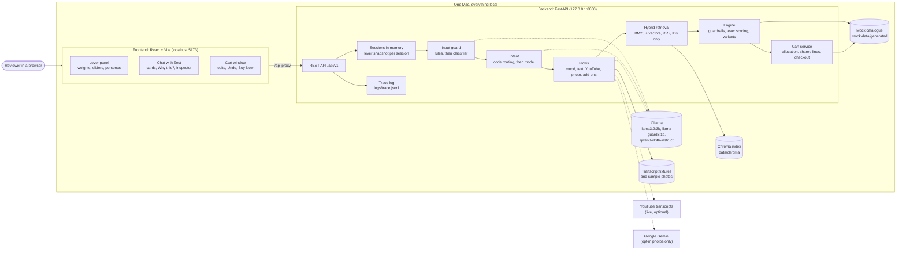
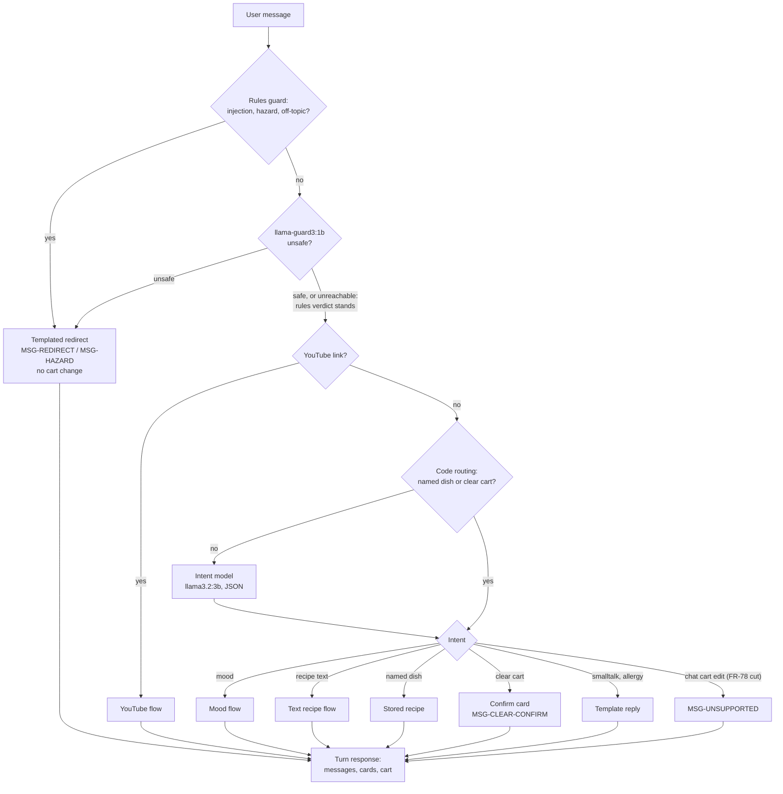
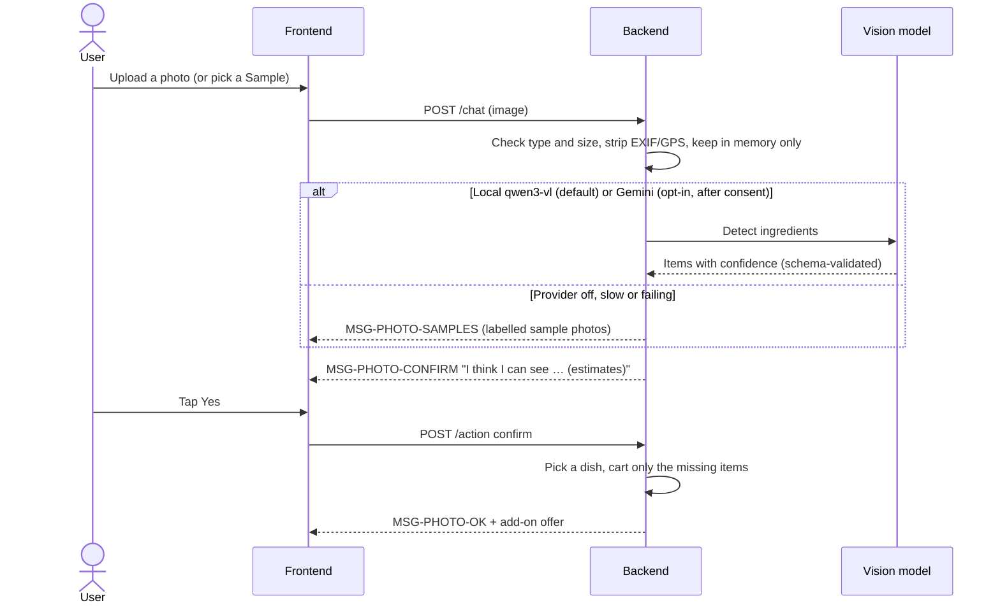
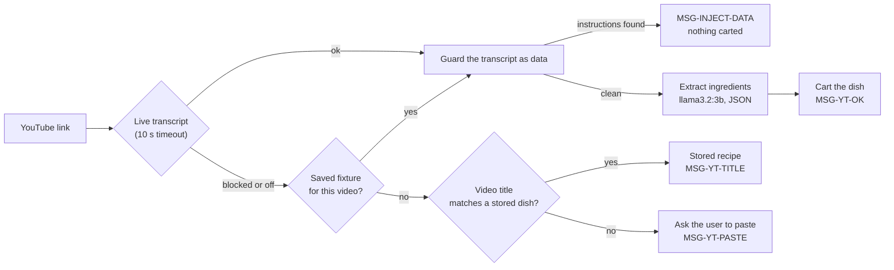
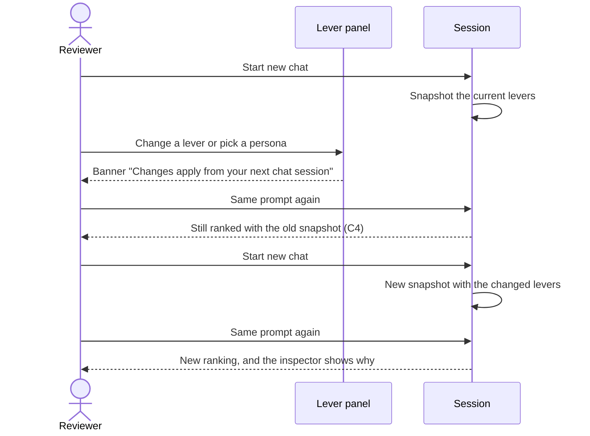
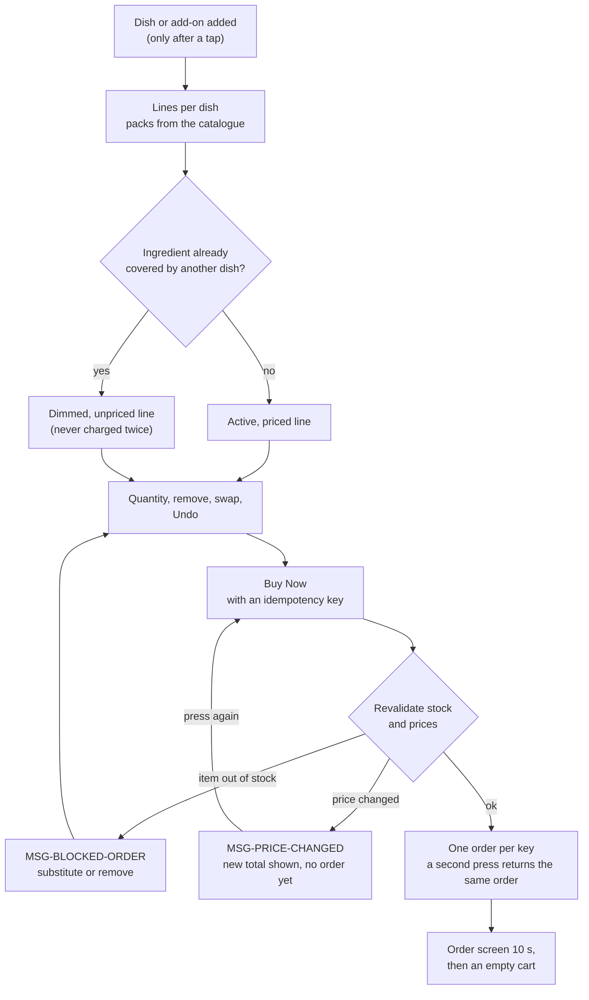

# Zest: an AI sous-chef for a mock quick-commerce store

Zest is a web-based cooking assistant linked to a **mock** grocery store, in the style of JioMart. Tell it what you want to cook in any of four ways:
- paste a YouTube recipe link
- type a recipe
- describe a mood ("I am feeling indulgent")
- upload a photo from your fridge

Zest builds a cart of real-looking products that you can edit and "buy".

The screen is split in two. On the left are **recommendation levers**: weights, purchase-history and trend sliders, persona filters (diet, faith, specialised diets) and business rules. On the right is the chat with Zest, plus a cart window. **Changing a lever changes what Zest recommends**, and an inspector shows why.

> **All commerce data is mock.** Products, brands, prices, stock and nutrition are generated by a seeded script. Nothing comes from a real store, and no real orders or payments happen.


*The running app, captured on 2026-10-19 from a fresh clone with the real local models: Meera Shah (Jain) preset, "I am feeling indulgent".*

This is a prototype: a working, documented, local demo with its evidence. It runs entirely on one Mac with local models;

## Status at a glance
The evidence report lists every evaluation, its pass rule, its result file and any post-hoc change. Every number in it is generated from `eval/results/`, none typed by hand:
**[docs/epics/zest/verify/report/report.md](docs/epics/zest/verify/report/report.md)**.

**Overall status: FAIL** under our own pre-registered rule (a missed gate on a Must objective fails the release). No FAIL is open and no critical failure was found. Four FAILs were accepted by the owner as known limitations.

| Status | Evaluations |
|---|---|
| PASS | E1 text model, E5 retrieval, E7 persona compliance (0 violations), E8 price integrity (0 mismatches), E9 intent to cart, E10 resilience (26 of 26 fault scenarios), E11 latency, E12 variant scoring, E13 reason lines, E14 traceability |
| FAIL, accepted | E2 intent classification (C55), E3 photo accuracy with the local model (C37), E4 input guard on held-out attacks (C56), E6 soft-lever sensitivity (C57) |

What these mean, and everything else that is limited or not built: **[Known Limitations and Responsible-AI Note](docs/epics/zest/release/known-limitations.md)**.

## Requirements
- An **Apple-silicon Mac with 16 GB of RAM**. Close other apps before a demo or a latency run: the three models together need most of the memory.
- **Apple's command-line tools** (they provide `make` and `git`). Install them with `xcode-select --install` if `make --version` fails.
- **Homebrew**, then **Python 3.12**, **Node 22 or newer** (Vite 8 needs it; developed on Node 26) and **Ollama**:
  ```bash
  brew install python@3.12 node ollama
  ```
- Ports **8000** and **5173** free on your machine.
- Internet access during setup (packages, models, embedder). After setup the app runs offline. Live YouTube transcripts need the network; the demo videos fall back to saved copies.
- Tested on an Apple-silicon MacBook Air with 16 GB and macOS. Intel Macs, Linux and Windows are untested.
- About **7 GB of disk** for the local models, plus about 1 GB for Python and Node packages.

| Model (Ollama) | Role | Size |
|---|---|---|
| `llama3.2:3b` | Intent, recipe extraction, the reason line (ADR-002) | 2.0 GB |
| `llama-guard3:1b` | Input guard, after the code rules (ADR-006) | 1.6 GB |
| `qwen3-vl:4b-instruct` | Photo detection (ADR-003) | 3.3 GB |

## Setup from a clean clone
Start the Ollama server first, and keep it running. Either open the Ollama app, or run this in its own terminal window:
```bash
ollama serve
```

Then, in another terminal:
```bash
git clone https://github.com/VarunParikh/zest-sous-chef.git
cd zest-sous-chef
make setup
ollama pull llama3.2:3b
ollama pull llama-guard3:1b
ollama pull qwen3-vl:4b-instruct
make index
make app
```

What each step does:
1. `make setup` creates `.venv` with Python 3.12, installs the pinned packages from `requirements.lock.txt`, creates `.env` from `.env.example` if it is missing, and runs `npm ci` for the frontend.
2. `ollama pull` downloads each model (about 7 GB in total). If it says it cannot connect, the Ollama server is not running: see above.
3. `make index` builds the local vector index in `data/chroma/`. The first run downloads Chroma's default embedder (all-MiniLM-L6-v2, about 80 MB) into `data/models/`.
4. `make app` starts the backend on http://127.0.0.1:8000 and the app on **http://localhost:5173**. Ctrl+C stops both. Open http://127.0.0.1:8000/health to check that the models, fixtures and index are ready. The first message after a start is slower while the models load (about 4 s; later mood replies take about 1.2 s).

If `make index` stops with a connection error while downloading the embedder, run it again. This happened once in our clean-clone check, and the retry succeeded (81 s on a home connection).

The generated catalogue (`mock-data/generated/`) is committed, so `make data` is only needed to regenerate it and run validators V1 to V17.

**Optional: Gemini photo analysis.** Photos use the local model by default, and labelled sample photos are the demo path and the fallback.
- To try Gemini instead, set `VISION_PROVIDER=gemini`, `VISION_MODEL=gemini-3.5-flash-lite` and `GEMINI_API_KEY=…` in your local `.env` only. Never put a key anywhere else.
- The first upload then shows a consent notice, because photos go to Google's free tier.

## Using Zest
- **Levers apply from the next chat session** (owner decision, C4). After changing one, a banner says so; press **Start new chat** to apply it.
- **Persona presets** set diet, faith and specialised diets in one click, for example Meera Shah (Jain) or Karan Malhotra (Keto, non-veg). Guardrails are filters in code, so a blocked item is never suggested or carted.
- **Four ways in:**
  - a YouTube link (live transcript, or a saved copy for the demo videos)
  - typed recipe text
  - a mood ("something comforting tonight")
  - a photo (detections are estimates you confirm)
- **"Why this?"** on every suggestion shows the biggest factors and the score breakdown. The **inspector** shows candidates, similarity, eligibility and final score.
- **The cart window** groups lines by dish, and dims a shared ingredient so it is never charged twice. You can change a quantity, swap, Undo and press **Buy Now** (one order per cart, then a 10-second order screen).

A 10-step walkthrough with exact inputs and fallback plays: **[Demo Script](docs/epics/zest/release/demo-script.md)**.

## How it works
Single-shot model calls turn text into schema-validated JSON; code does everything exact. One chat turn goes:
1. **Input guard:** code rules, then `llama-guard3:1b`.
2. **Intent:** code routing for named dishes and cart clears, else the text model.
3. **Hybrid retrieval:** BM25 plus Chroma, fused by reciprocal rank fusion. It returns IDs only.
4. **Guardrails in code:** diet, faith, allergy and stock filters run after retrieval.
5. **Lever scoring:** the four weights and the sliders rank a wide pool, and three are shown.
6. **Variant choice:** lever scores plus a price value term.
7. **Pure-code cart:** pack allocation, shared lines, Undo and an idempotent checkout.

The model never sets a price, a SKU or eligibility, and text from videos, photos and pages is treated as data, not instructions.

Details: [architecture](docs/epics/zest/design/architecture.md) and the [ADRs](docs/epics/zest/design/adr/README.md).

## Diagrams
GitHub renders these Mermaid diagrams directly. They describe what is built; cut features are marked as such.

### System architecture


### One chat turn


### Recommendation pipeline (mood requests)

```mermaid
flowchart LR
  q["Mood words<br/>and mood tags"] --> open{"Open request?<br/>e.g. I am hungry"}
  open -- "yes" --> course["Whole course pool<br/>(ADR-004 v3)"]
  open -- "no" --> hybrid["Hybrid retrieval<br/>BM25 + Chroma, RRF k 60<br/>pool of 25 dish IDs"]
  hybrid -. "vector store down" .-> lexical["Lexical only<br/>(FR-117)"]
  course --> filt
  hybrid --> filt
  lexical --> filt
  filt["Guardrails in code<br/>diet, faith, allergy, stock"] --> score["Lever scoring<br/>4 weights, history, trends,<br/>gourmet, organic, price cap"]
  score --> top["Top 3, no repeats<br/>in the session"]
  top --> variants["Variant choice per ingredient<br/>lever scores + price value term"]
  variants --> alloc["Pack allocation<br/>from the catalogue"]
  alloc --> reason["Reason line<br/>model writes, validator checks,<br/>template if it fails"]
  reason --> cards["Dish card, 2 swaps, Undo,<br/>Why this?, one add-on offer"]
```


### Photo flow


### YouTube transcript fallback chain


### Levers and sessions


### Cart and checkout


## Why these models
Every model was chosen by a benchmark that was written and pre-registered before any model ran (`eval/thresholds.yaml`, datasets hashed in `eval/datasets/MANIFEST.json`). The ADRs record each decision and its caveats. All numbers below are read from the result files in [`eval/results/`](eval/results/), measured on the demo Mac (Apple M5 MacBook Air, 16 GB).

### Why local at all
The brief and the Constitution set the constraints:
- **Free, local and offline by default.** No paid API is needed, so the demo works without a network (Constitution G3 and P9).
- **Private by default.** Photos are stripped of EXIF data and stay on the laptop unless the user opts in to Gemini (P9).
- **No cloud fallback for text.** If no local text model had passed, the plan was to shorten prompts or pick a smaller model, not to call a cloud model (build plan §8).

The cost of this choice is that every model has to fit, together, in 16 GB beside the backend and the vector index. That memory budget drove most decisions below.

### Text model: `llama3.2:3b` at a 4k context (ADR-002, evaluation E1)
**Task:** extract ingredient lists from recipes and transcripts (including Hinglish), classify intent, and write the one reason line.

**Gates:** extraction F1 ≥ 0.80, valid JSON ≥ 95%, and ≥ 3 GB of RAM left free.

| Candidate | Extraction F1 | Valid JSON | Latency median / p95 | Free RAM after | Result |
|---|---|---|---|---|---|
| **`llama3.2:3b`**, 4k context, other apps closed | **0.86** | **5/5** | **4.2 s / 5.4 s** | **6.7 GB** | **PASS** (owner-approved post-hoc rerun) |
| `llama3.2:3b`, Ollama default 16k context | 0.86 | 5/5 | 4.6 s / 5.8 s | 2.1 GB | FAIL (memory only) |
| `qwen2.5:7b`, 16k context | 0.55 | 3/5 | 11.2 s / 23.8 s | 2.1 GB | FAIL |
| `qwen3:4b-instruct`, 16k context | 0.40 | 2/5 | 16.0 s / 27.4 s | 2.4 GB | FAIL |

**Why:**
- `llama3.2:3b` was the only candidate with good extraction quality, and it never invented an ingredient (0 of 41 items).
- At Ollama's default 16k context it left too little memory. A 4k context cut the loaded model from 4.0 GB to 2.6 GB, and the rerun passed every gate.
- The two Qwen models failed on quality (low F1, invalid JSON on the Hinglish and transcript rows), not just on memory.

**Caveats:**
- Only 5 test recipes, so the intervals are wide.
- The rerun changed two things at once: a smaller context and closed apps.
- Long YouTube transcripts are capped to fit the 4k window.

### Input guard: rules, then `llama-guard3:1b` (ADR-006, evaluation E4)
**Alternatives:** rules alone, or rules plus a small safety classifier.

**Day-1 evidence:**
- Rules alone blocked 9 of 13 attacks.
- Rules plus `llama-guard3:1b` blocked 12 of 13, with no false positives in 7 benign prompts.
- The classifier costs about 1.7 GB and 53 ms per call (median).

**Held-out set (`guard_v3`, never seen while writing rules):**
- Rules alone block 0.30 of attacks.
- Rules plus classifier block 0.55.

**Why:** the classifier still roughly doubles what the rules catch on phrasings nobody tuned for. The result is still below the 0.90 gate, which is an owner-accepted limitation (C56). Harm is contained in code: no attack changed a cart end to end (E9), and no ineligible item reached a persona (E7).

**Tuning:** two of its categories are ignored. Specialised advice, because "what should I eat?" was flagged. Intellectual property only when the message contains a YouTube link, because every bare video link was flagged (C40, C44, C55).

### Photo detection: `qwen3-vl:4b-instruct` locally, Gemini as opt-in (ADR-003, evaluation E3)
**Gates:** precision ≥ 0.80 and recall ≥ 0.70 on clear photos, with p95 ≤ 20 s while the text model is loaded. Measured on 11 labelled photos, 3 runs each:

| Candidate | Precision | Recall | Latency median / p95 | Failed calls | Result |
|---|---|---|---|---|---|
| **`qwen3-vl:4b-instruct`** (local) | **0.68** (108/159) | **0.43** (108/252) | **7.1 s / 109.8 s** | **6 of 33** | FAIL |
| `gemma4:e2b-it-qat` (local) | 0.44 (31/70) | 0.12 (31/252) | 20.4 s / 51.0 s | 12 of 33 | FAIL |
| Gemini 3.5 Flash-Lite (cloud, reference) | 0.77 (159/207) | 0.63 (159/252) | 1.6 s / 3.5 s | 0 of 33 | FAIL (just under both gates) |
| `qwen3-vl:8b-instruct` (local) | — | — | — | — | NOT RUN (owner decision: time and memory; the 4b model already swapped) |

**Why:**
- No model passed, so photo accuracy is reported as **NOT MET** (accepted, C37).
- The owner chose the best local model as the default to keep photos on the laptop. `qwen3-vl:4b` beat `gemma4` on both precision and recall.
- Gemini is the more accurate opt-in, behind a consent notice, because its free tier may use photos to improve Google's products.

**Containing the weakness:**
- Detections are labelled estimates, and the cart changes only after the user confirms with a tap.
- Labelled sample photos are the demo path, and the fallback when analysis is slow (60 s timeout) or fails.
- On the four demo photos, E11 measured a 7.6 s median and a 12.5 s p95 for the full upload-and-confirm flow.

### Embedder: Chroma's default all-MiniLM-L6-v2 (ADR-005, evaluation E5)
**Alternative:** `nomic-embed-text` through Ollama.

| Embedder | Hybrid recall in the pool | Mood subset | MRR | Index build at 5,135 variants | Query latency median |
|---|---|---|---|---|---|
| **all-MiniLM-L6-v2** (Chroma default, ONNX) | **30/30** | **7/7** | **0.88** | **54 s** | **8.4 ms** |
| `nomic-embed-text` (Ollama) | 30/30 | 7/7 | 0.89 | 62 s | 14.1 ms |

**Why:**
- The two tied on recall.
- MiniLM runs inside the backend process, so no fourth model sits in Ollama's memory (nomic needs about 335 MB beside the text model and the guard).
- It builds the index faster, and it showed no measured quality loss on this set.
- nomic stays available (`EMBEDDING_PROVIDER=ollama`). It was run without its recommended task prefixes, which may understate it.

**Retrieval method:** hybrid BM25 plus vectors (reciprocal rank fusion, k 60) was chosen over lexical-only. It found the right dish in every mood query, while lexical-only found 5 of 7 (ADR-004).

### What would change the choice
- **Text:** a larger model fits only with fewer models resident or more memory. Any change would be rerun against the same E1 set.
- **Vision:** `qwen3-vl:8b` was not benchmarked, to save time and because the 4b model already swapped memory. It is the first candidate to try on a 24 GB machine; on this Mac, Gemini (opt-in) is the accuracy option.
- **Guard:** a classifier tuned on held-out attack phrasings, measured on a set written by someone other than the rule author (see [Prototyping Feedback](docs/epics/zest/release/prototyping-feedback.md)).

## Tests and evaluations
| Command | What it proves | Time (measured on the demo Mac) |
|---|---|---|
| `make test` | Over 600 unit, contract and acceptance tests with fake models | about 10 s |
| `make test-e2e` | The demo path (E2E-001) and inert rendering of markup (T-075) in headless Chromium. Needs Playwright's browser once: `.venv/bin/python -m playwright install chromium` | about 15 s plus a frontend build |
| `make test-embedder` | Retrieval with the real embedder | about 15 s |
| `make data` | Regenerates the catalogue and runs validators V1 to V17 on the 1,000- and 5,000-variant sets | under a minute |
| `make scan` | Secret scan of the working tree and full git history | seconds |
| `make eval` | Reruns every headline evaluation with the real models | long; stop `make app` and close other apps first (E11) |
| `make report` | Rebuilds the evidence report from `eval/results/` only; fails if a required evaluation has no result | seconds |

Results so far are in [`eval/results/`](eval/results/). Reruns after a change go to `eval/results/post-hoc/`, and first results are always kept.

## Repository map
| Path | Contents |
|---|---|
| `src/backend/` | FastAPI app: guard, intent, retrieval, engine (eligibility, scoring, variants), cart, flows, trace |
| `src/frontend/` | React + Vite + Tailwind single-page app |
| `mock-data/` | Seed taxonomy, lexicon, dishes, pairings, personas, transcript fixtures, generator and validators |
| `eval/` | Datasets (hashed before any run), thresholds, results, headline map |
| `scripts/` | Benchmarks, report builder, index builder, secret scan, doc check |
| `tests/` | Unit, acceptance, integration and E2E tests |
| `docs/core/` | Constitution, strategy, conflicts log (C1 to C74), approval register |
| `docs/epics/zest/` | Discovery, requirements, design, verification and release documents |

Documents for the work itself:
- [build plan](docs/epics/zest/build-plan.md)
- [PRD](docs/epics/zest/requirements/product-spec.md)
- [user stories](docs/epics/zest/requirements/user-stories.md)
- [test plan](docs/epics/zest/verify/test-plan.md)
- [evaluation plan](docs/epics/zest/verify/evaluation-plan.md)
- [prototyping feedback](docs/epics/zest/release/prototyping-feedback.md)

## Known limitations (short version)
- **The input guard misses many novel attacks** (11 of 20 blocked on a held-out set). It also redirects some ordinary phrases, such as an unknown dish name or "switch off the oven". Harm is limited because the code checks every cart change.
- **Soft levers move the top three less than hoped.** Hard filters (diet, faith, specialised diets) change results strongly.
- **Local photo detection is slow and misses items** (recall 0.43 on clear photos). Detections are estimates you confirm, and sample photos are always available.
- **Mock, assistant-written data and small evaluation sets.** English only.
- **Not built:** chat cart edits, servings scaling, live stock-out controls, post-order pairing.

## Licence and data
- **Licence:** MIT; see [LICENSE](LICENSE).
- **Data:** all catalogue and persona data is synthetic. Sample photos are the owner's own.
- **Secrets:** the optional Gemini key lives only in the git-ignored `.env`. The repository and its history are scanned for keys before each push.
