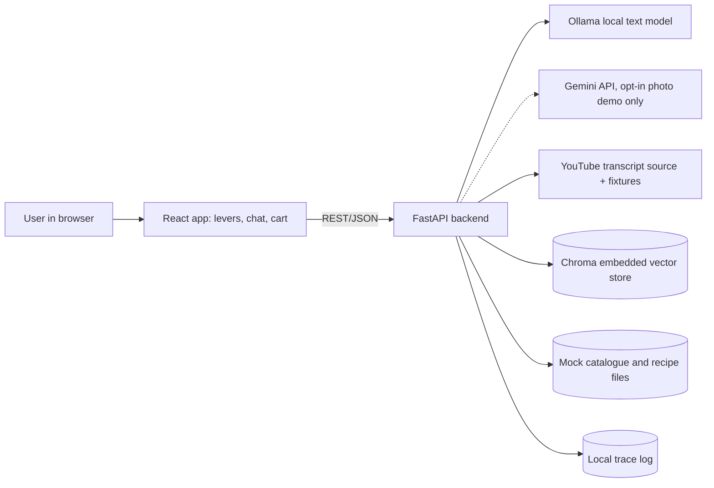
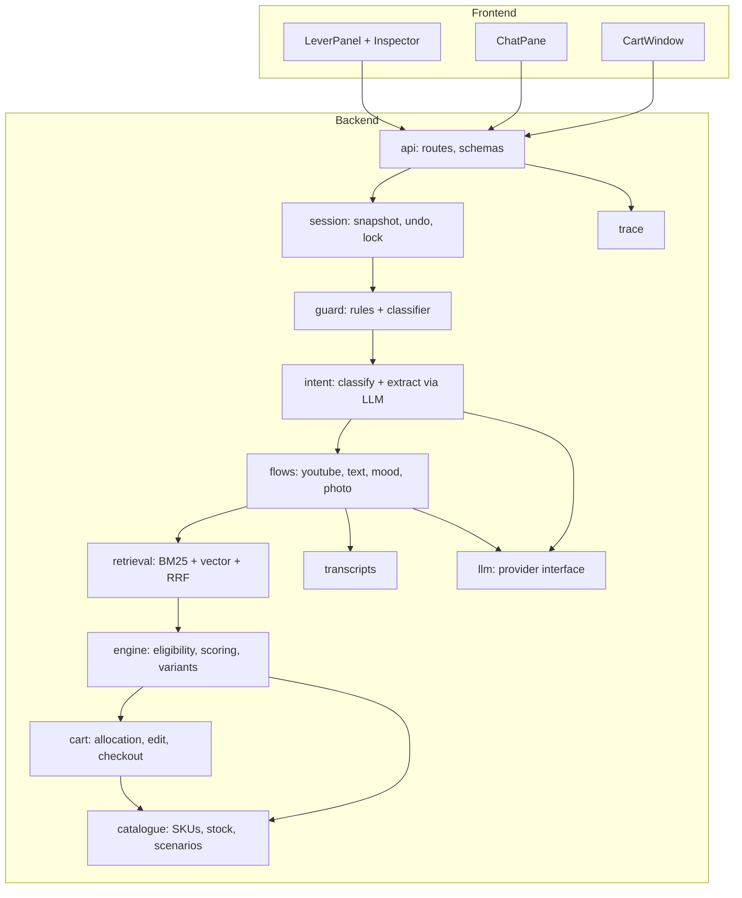
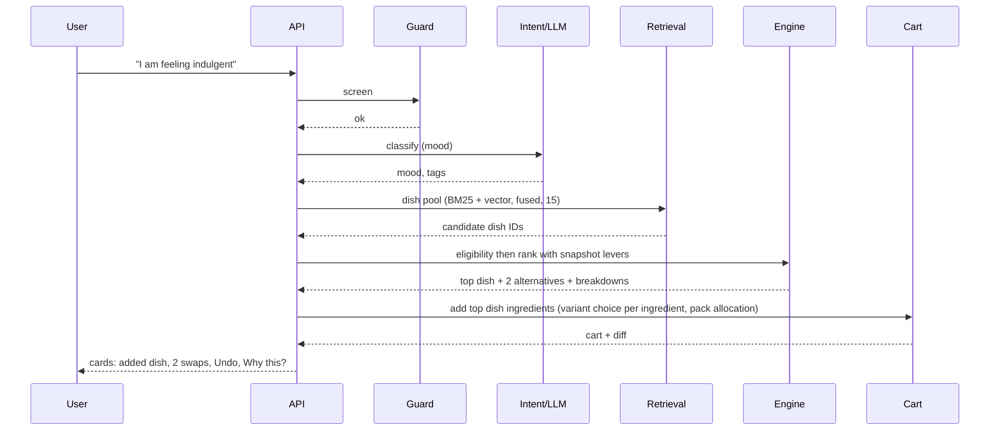

# Architecture: Zest AI Sous-Chef

Status: **DRAFT (amended) v0.5 (2026-10-18): §6 adds `GUARD_IGNORE_CATEGORIES` (ADR-006 v2, C40); awaits owner re-approval.** v0.4 was APPROVED (owner re-approved 2026-10-18) (2026-10-18): C37 doc-sync to ADR-003 v3 (local `qwen3-vl:4b-instruct` default, Gemini opt-in, samples for the demo and as fallback). ** v0.3 was APPROVED (owner, 2026-10-18), re-approved after the C15 sync to the ADR-003 Day-1 decision.** v0.2 was APPROVED (owner, 2026-10-17) (v0.1 was approved earlier the same day; v0.2 syncs to ADR-004 v2: add-on retrieval) · Date: 2026-10-17 · Source: PRD v0.4, Data Model v0.2, Constitution v0.2, ADR-001 to ADR-010
Scope: components, boundaries, data flows, failure handling and quality attributes. Field definitions are in the Data Model; endpoints will be detailed in the API Spec; prompts and tool contracts in the Agent Design.

## 1. Architectural stance
1. **A deterministic pipeline with language-model steps, not a free-roaming agent.** The model interprets language (intent, ingredient extraction, short replies). Code does everything that must be exact: retrieval, eligibility, scoring, variant choice, pack allocation, pricing, cart and checkout. This is how Constitution P2 and P3 are enforced.
2. **Narrow interfaces to every dependency** (model, vision, transcripts, vector store, catalogue), so each can fail, be replaced or be faked in tests.
3. **Everything runs on one laptop.** No hosting, no accounts (apart from an optional Gemini API key held in a local `.env` for the opt-in photo demo).
4. **The reviewer can see inside.** Every request leaves a trace, and the lever panel shows retrieval and scoring (FR-115).

## 2. System context

Trust boundaries: browser to backend (untrusted input); backend to Gemini (the only possible cloud call: the opt-in photo demo, off by default, consent notice first); backend to transcript source and any fetched text (untrusted content, treated as data, FR-12). Text prompts never leave the laptop.

## 3. Components

| Module | Responsibility | Depends on |
|---|---|---|
| `api` | HTTP routes, request and response schemas, error mapping | session |
| `session` | Lever snapshot (FR-01), processing lock (FR-102), undo stack | cart, engine |
| `guard` | Input and fetched-content screening (FR-10, 12). Rules first, classifier second | llm (optional) |
| `intent` | Classify message type; extract dish and ingredients as schema-validated JSON (FR-11, 21) | llm |
| `flows` | One module per entry method (B1 to B4): orchestrates steps, owns fallbacks | all below |
| `retrieval` | BM25 lexical + Chroma vector + reciprocal rank fusion; returns candidate IDs only (FR-110 to 112) | catalogue, Chroma |
| `engine` | Eligibility mask, `S_final`, variant score, ties, context (FR-60 to 67, 113) | catalogue |
| `catalogue` | Read-only SKU, variant, dish, recipe, synonym data; mutable stock; stock scenarios | files |
| `cart` | Pack allocation, shared lines, edits, revalidation, checkout, idempotency (FR-71 to 83) | catalogue |
| `llm` | Ollama text client; vision providers `ollama` with `qwen3-vl:4b-instruct` (default, ADR-003 v3), `gemini` (opt-in) and `samples` (demo path and fallback) behind one interface; timeouts, one retry, schema validation (G5, NFR-10) | config |
| `transcripts` | Live fetch, then fixture, then title and description (FR-20) | network |
| `trace` | JSONL events, no images, truncated text (NFR-06) | none |

Rule: `guard`, `engine` and `cart` contain no LLM calls and can be fully unit-tested.

## 4. The core pipeline (one chat turn)
1. **Lock** the session input (FR-102) and screen the message with `guard`.
2. **Classify** intent (`intent` + `llm`, temperature 0).
3. **Route** to a flow. Each flow does: understand, retrieve a wide pool, apply hard guardrails in code, rank survivors with the snapshot levers, act (cart change or reply), explain.
4. **Validate** every number in the reply against the catalogue (FR-79) before sending.
5. **Trace** the turn; **unlock**.

### 4.1 Mood flow (B3)

### 4.2 Photo flow (B4)
Default (ADR-003 v3, 2026-10-18): upload validation (FR-57) → metadata stripped, bytes held in memory only → the local `qwen3-vl:4b-instruct` returns detections with confidence (schema-validated, 60 s timeout) → detections confirmed with one tap (MSG-PHOTO-LOW for unsure items, else MSG-PHOTO-CONFIRM) → dish pool from detected items (BM25 + vector) → eligibility → rank → add the top dish's missing items → swaps and Undo → image discarded. Opt-in Gemini adds the consent notice before the first upload. A sample photo skips the model and uses its pre-computed detections (the demo path). If the provider fails or times out, bundled labelled sample photos are offered (FR-55).

### 4.3 YouTube flow (B1)
Validate URL (FR-24) → transcript chain (live, fixture, title and description, paste prompt) → guard on fetched text → LLM extracts dish and ingredient lines → retrieval maps each ingredient to variants → engine picks variants and persona-filters → cart allocation → pantry question for staples (FR-23).

### 4.4 Text recipe flow (B2)
Each message → extraction → ingredients carted immediately under the open dish (FR-30). A named dish with no ingredients uses the stored recipe; an unknown dish triggers the nearest-dish pool (FR-33).

## 5. Recommendation engine (inside `engine`)
```
pool (IDs) → eligibility mask (diet, faith, specialised, stock, price cap, allergens) → components s_p, s_h, s_t, s_g
          → normalise (rank-based for s_p) → S_final = M × Σ(ŵ_k × s_k)   [dishes, add-ons, substitutes]
variants:   S_v = M × [(1 − β) Σ(ŵ_k s_k) + β × value],  β = 0.30 × (1 − gourmet)
          → ties: s_p, then ID → top results + ScoreBreakdown
```
The pool must be larger than the display set, otherwise the levers cannot reorder anything (FR-111, risk R24).

**Add-on path (ADR-004 v2).** For a cart dish, `retrieval` builds two lists: curated companions from `pairings.csv` and the nearest neighbours of the dish's stored embedding in `zest_dishes`. A course rule (`ADDON_COURSES`) filters the vector list; weighted RRF (`ADDON_WEIGHTS`, curated 2 : vector 1) merges them; the fused rank becomes the add-on `s_p`. Eligibility and the add-on price cap then run in code, and the levers rank the survivors. An add-on enters the cart only after a tap (FR-64).

## 6. Configuration (`.env` and `config.yaml`)
| Key | Purpose | Default |
|---|---|---|
| `LLM_PROVIDER`, `LLM_MODEL` | Local text model | `ollama`, chosen by benchmark |
| `VISION_PROVIDER`, `VISION_MODEL`, `GEMINI_API_KEY` | Photo analysis (key only in local `.env`) | `ollama` with `qwen3-vl:4b-instruct` (ADR-003 v3); opt-in `gemini` with `gemini-3.5-flash-lite`; `samples` |
| `EMBEDDING_PROVIDER`, `EMBEDDING_MODEL` | Vector embedder | Chroma default ONNX |
| `RRF_K`, `DISH_POOL`, `VARIANT_POOL`, `AMBIGUITY_MARGIN` | Retrieval tuning | 60, 15, 10, 0.15 |
| `ADDON_COURSES`, `ADDON_WEIGHTS`, `ADDON_POOL` | Add-on retrieval: companion courses for the vector list; curated and vector fusion weights; add-on pool size (proposed names and starting values, tuned by the ADR-004 v2 weight sweep) | `side,beverage,dessert`; curated 2, vector 1; 8 |
| `VALUE_WEIGHT` | β0 for variant price term | 0.30 |
| `TIMEOUT_LLM_S`, `TIMEOUT_VISION_S`, `TIMEOUT_TRANSCRIPT_S` | NFR-10 | 30, 60 (ADR-003 v3), 10 |
| `LIVE_TRANSCRIPTS`, `MAX_RECIPE_CHARS` | Live YouTube transcript fetch on or off; transcript and recipe text cap for the 4k context (C39) | `true`, 6000 |
| `CONFIDENCE_THRESHOLD` | Photo detection | 0.6 |
| `GUARD_CLASSIFIER`, `GUARD_MODEL`, `GUARD_IGNORE_CATEGORIES` | Second guard layer on text the rules pass; classifier categories that do not block (ADR-006 v2; C36, C40) | `true`, `llama-guard3:1b`, `S8` |
| `INTENT_CONFIDENCE_MIN` | Below it, the intent result triggers MSG-REPHRASE, never an action (Agent Design §6.1; C36 doc-sync) | 0.5 |
| `CONTEXT_NOW`, `CONTEXT_WEATHER` | Reproducible trend context | system clock, mock label |

## 7. Failure handling
| Dependency fails | Detected by | Behaviour |
|---|---|---|
| Local model: timeout or invalid JSON | timeout, schema check | One retry, then rephrase request; trace `fallback_used` |
| Opt-in Gemini: error, rate limit, timeout | provider interface (one retry on 429 or 5xx) | Labelled sample photos |
| Transcript source blocked | exception | Fixture, then title and description, then paste prompt |
| Vector store or embedder | startup check and call error | Lexical-only retrieval; add-ons from the curated list alone (FR-117) |
| Catalogue stock change | revalidation at Buy Now | Block order until swap or remove (FR-83) |
| Backend unreachable | frontend fetch error | Failure copy (NFR-02) |

## 8. Security and privacy hooks
Guard in front of every model call; fetched content wrapped as data with no tool authority; the model has no direct cart tool, only structured outputs that code validates; secrets only in `.env`; EXIF stripped and images never written to disk; trace has no images; Chroma and logs are git-ignored. Details in the Security and Privacy Note.

## 9. Quality attributes
| Attribute | How the architecture serves it | Verified by |
|---|---|---|
| Lever causality | Wide pool, pure engine function, snapshot input | AC-01 to 03, 36, 38, 42; Ranking Divergence Index |
| Correctness of constraints | Guardrails in code after retrieval | Persona tests AC-04 to 06, 25, 37 |
| Resilience | Interfaces with fallbacks | AC-11, 16, 40; fault-injection tests |
| Testability | LLM and vision behind fakes; engine and cart pure | Unit and acceptance tests |
| Observability | Trace events; inspector | AC-34, 41 |
| Reproducibility | Seeded data, pinned versions, temperature 0 | V13; NFR-08, 11 |

## 10. Run and deployment view
Three local processes: Ollama daemon, backend (`uvicorn`), frontend (Vite dev server or built static files served by the backend). One command (`make dev` or a shell script) starts the backend and frontend, builds the Chroma index if missing, and prints a health summary. No containers are required. A health page lists model loaded, vision provider status, fixtures present and index ready.

## 11. Repository layout (planned)
```
src/backend/{api,session,guard,intent,flows,retrieval,engine,catalogue,cart,llm,transcripts,trace}
src/frontend/{components,state,api}
mock-data/{taxonomy,lexicon,dishes,fixtures,generated}   data/chroma   logs/
tests/{unit,acceptance,e2e,eval}   docs/   scripts/{build_data,index,benchmark,serve}
```

## 12. Open items
1. The text model, guard design and embedder are decided by Day-1 benchmarks (ADR-002, 006, 005).
2. The API Spec will fix routes and error codes; the Agent Design will fix prompts and schemas.
3. Frontend state management library (a small store versus React context) is an implementation choice recorded in ADR-010 and is not yet decided.

## 13. Sources
| Source | Used for | Link |
|---|---|---|
| FastAPI documentation | Backend framework | https://fastapi.tiangolo.com/ |
| Chroma documentation (embedding functions, via Tessl) | Embedded vector store | https://tessl.io/registry/tessl/pypi-chromadb/files/docs/embedding-functions.md |
| Greshake et al. (2023), indirect prompt injection | Trust boundaries for fetched content | https://arxiv.org/abs/2302.12173 |
| Cormack et al. (2009), Reciprocal Rank Fusion | Fusion in `retrieval` | https://doi.org/10.1145/1571941.1572114 |
| Burke (2002), hybrid recommender systems | Engine structure | https://doi.org/10.1023/A:1021240730564 |
